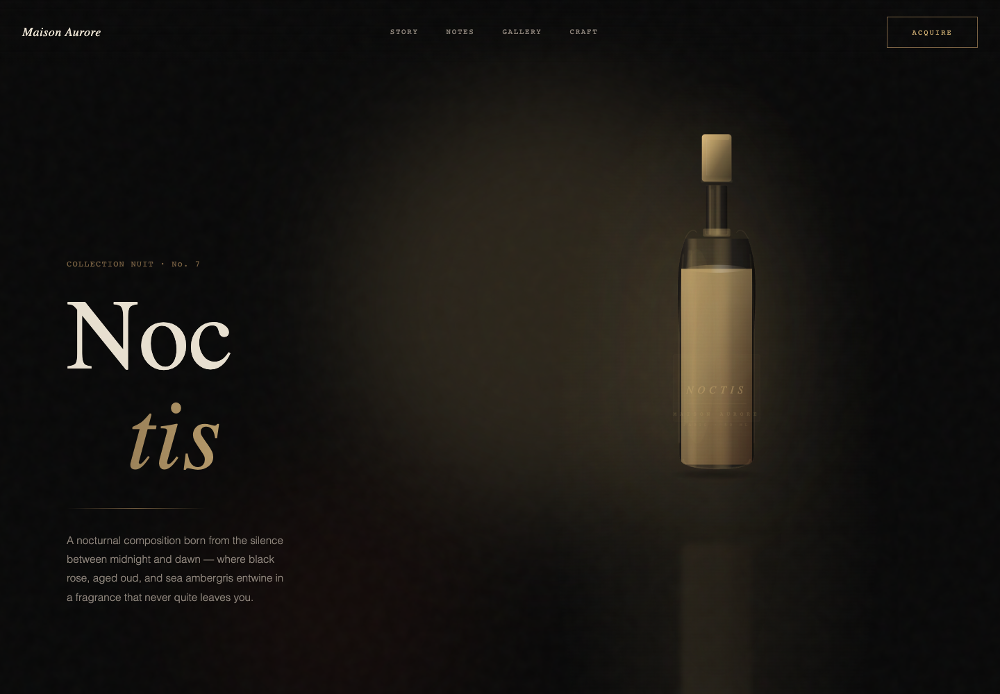
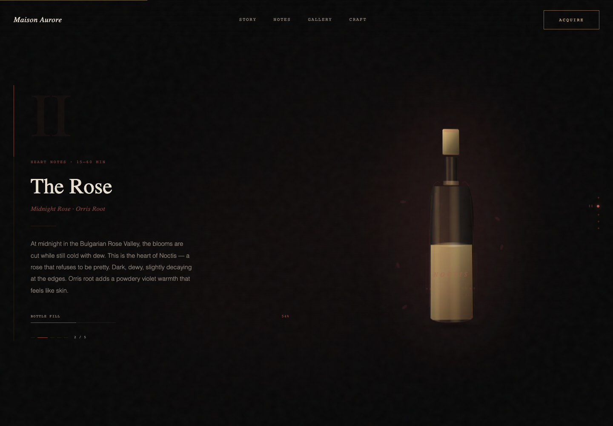
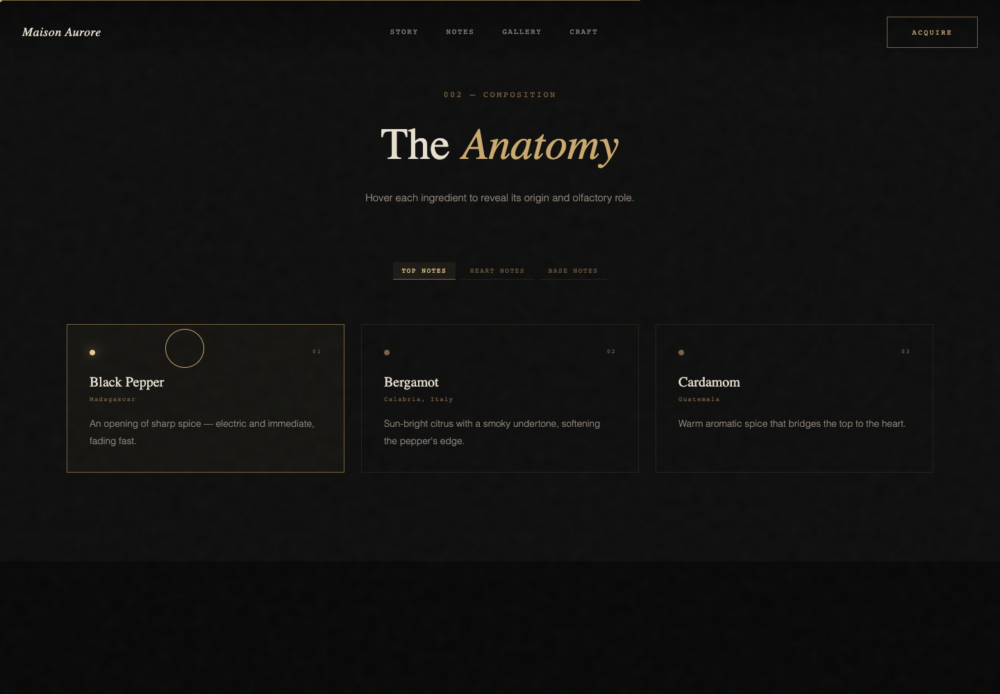
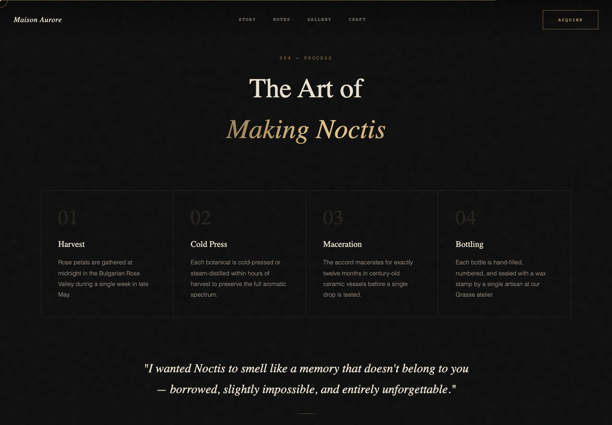
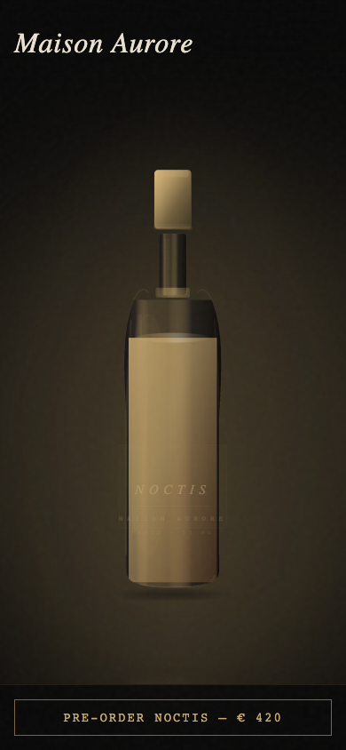

<div align="center">

# Aroma

### A fragrance story, told through light, texture and motion.

A luxury perfume website concept for **Noctis by Maison Aurore**.<br />Built to showcase art direction, interactive product storytelling and frontend craftsmanship.

[Design](#design-highlights) · [Experience](#the-experience) · [Screenshots](#screenshot-gallery) · [Run locally](#run-locally)

</div>



## Design highlights

Aroma gives a single product an atmospheric, editorial stage: near-black surfaces, muted gold accents, oversized italic type and a fine animated grain. A custom SVG bottle brings the product into focus through layered glass, liquid, reflections and ambient glow.

- **Product as the centerpiece.** Pointer movement tilts the bottle; a softened reflection grounds it in the scene.
- **A story with a visual rhythm.** Five scroll-driven chapters change the bottle’s fill, color, lighting and decorative particles as the fragrance unfolds.
- **Details that carry the identity.** Fine rules, monospaced labels, a moving marquee, shimmer effects and staggered reveals connect the sections.
- **Layouts that adapt.** The hero stacks on smaller screens, content grids reflow, and a fixed mobile purchase prompt stays within reach.

## The experience

| Element | Implemented behavior |
| --- | --- |
| Fragrance story | Sticky scene with five chapters, changing copy, chapter markers and a bottle-fill indicator |
| Composition explorer | Top, heart and base note filters, with nine ingredient descriptions and hover highlights |
| Navigation | Header buttons scroll to Story, Notes, Gallery and Craft; the wordmark returns to the hero |
| Atmosphere & craft | Six-image editorial gallery with hover styling, four process cards and reveal animations |
| Interface motion | Custom desktop cursor, pointer-responsive bottle, animated marquee and page progress line |
| Demo calls to action | Acquire and Reserve display explanatory alerts; the newsletter provides local confirmation only |

**Concept project.** Brand history, product details, prices, stock counters, contact details and testimonials are illustrative content. Checkout, reservations and email subscriptions are not connected to services.

## Screenshot gallery

Captured from the unchanged production build in isolated, non-touch Chrome sessions, including a 390 px mobile viewport. All external requests were blocked before navigation: Google Fonts fall back to system fonts, and Unsplash gallery photography is intentionally unloaded. Images show the actual rendered UI, with no substituted assets.

| Scroll storytelling | Composition explorer |
| --- | --- |
|  |  |

| Craftsmanship section | Mobile first viewport · 390 px |
| --- | --- |
|  |  |

[View the full desktop page](docs/screenshots/desktop-full-page.png) · [View mobile composition](docs/screenshots/mobile-notes.png)

## Technology

**React 19 · TypeScript 5.7 · Vite 8 · Tailwind CSS 4**

React hooks coordinate pointer, scroll and selection state. Native SVG supplies the bottle artwork, CSS handles presentation and animation, and IntersectionObserver drives section reveals. The project includes Figma Make configuration and uses oxfmt for formatting. Google Fonts and Unsplash are external visual resources used by the site.

## Project structure

```text
src/
  App.tsx              # Page, bottle artwork, story and interactions
  index.css            # Theme, typography, animation and responsive rules
  main.tsx             # React entry point
docs/screenshots/      # Authentic browser captures
.figma/make/           # Figma Make scripts and site metadata
index.html             # HTML shell
vite.config.ts         # React, Tailwind and Figma Make tooling
```

The repository also retains earlier source snapshots and a separate bottle component; the active page is mounted from `src/App.tsx`.

## Run locally

The toolchain file specifies **Node.js 22** and **pnpm 10.34.3**. With those tools installed:

```bash
git clone https://github.com/sahilbhardwaj037037-sys/Aroma.git
cd Aroma
pnpm install --frozen-lockfile
pnpm exec vite --host 127.0.0.1 --port 8443
```

Open **http://127.0.0.1:8443**. If a Figma Make preview is already running, use its existing preview panel.

```bash
pnpm build            # Production output in dist/
pnpm exec tsc --noEmit
pnpm exec vite preview --host 127.0.0.1 --port 8443
```

The preview command serves a completed build. Fonts and gallery photography require an internet connection.

## Usage & verification

Scroll through the story, switch composition categories and hover an ingredient or the bottle to explore the interactions. Use the desktop header to move between sections. On narrow screens, the page uses a stacked layout and fixed purchase prompt; there is no mobile navigation menu.

Production build and TypeScript checks pass; the build reports existing responsive CSS selector warnings. Browser checks at **1440, 768, 390 and 320 px** verified all five story chapters and three note filters. Non-touch layouts at 1440, 390 and 320 px showed no document overflow; 768 px briefly measured 24 px of overflow during reveals. **Touch-enabled emulation currently triggers a React hook error and a blank page**, so the mobile images demonstrate viewport layout rather than verified touch-device support.

The full-page image is a static record of a scroll-driven experience; chapter captures best convey the sticky story.
